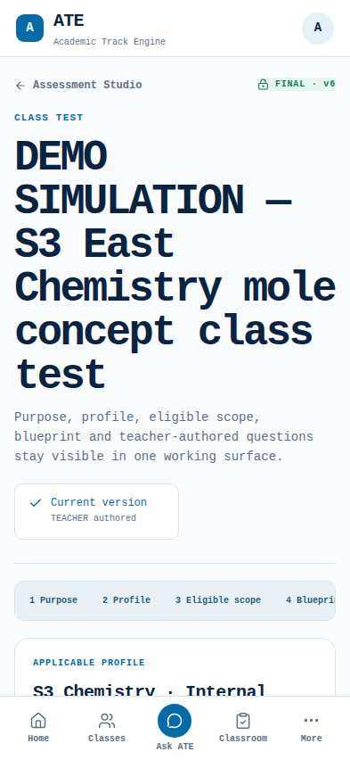
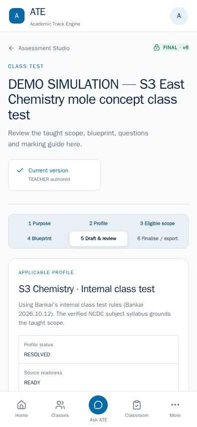
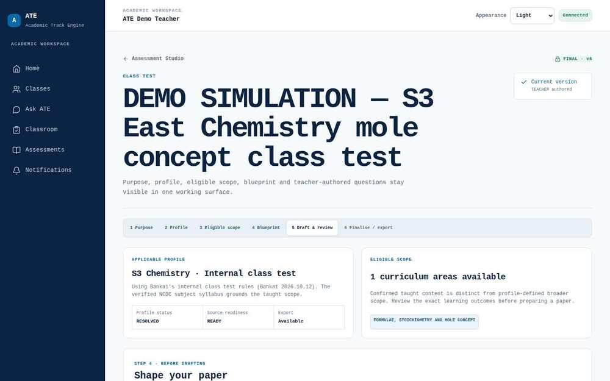
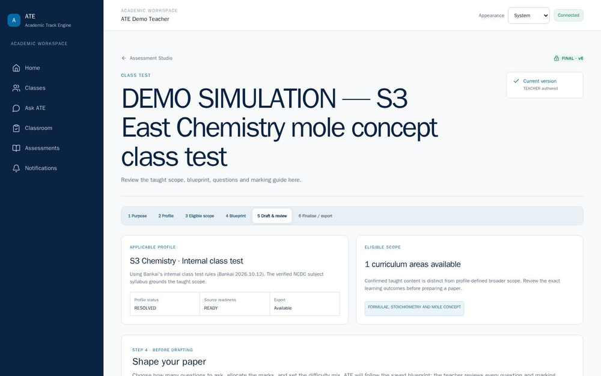

# ATE controlled pilot screen evidence

Authenticated demo teacher, 13 October 2026 (Africa/Kampala). The **before** images are from preview commit `9f6381c`; the **after** images are from `39772a5`. The assessment is a labelled DEMO SIMULATION, not genuine classroom evidence. Mobile viewport: 393 × 852. Desktop viewport: 1440 × 900, resized to 1000 px for repository review.

| View | Before | After |
| --- | --- | --- |
| Assessment Studio, mobile |  |  |
| Assessment Studio, desktop |  |  |

The after screenshots show the compact title, visible six-step workflow, released class-test profile, confirmed East stream scope, and the mobile bottom navigation. The administrator was signed in separately on the final commit and loaded [School setup](admin-ready.jpg), including the active controlled-pilot timetable. These screenshots show the top of each screen; they do not substitute for the end-to-end assessment and export tests.

[Standalone Chromium app-window Home](pwa-app-mobile.jpg) was captured with the authenticated teacher at 393 × 852. The browser reported `display-mode: standalone` and an active service worker. This verifies the app-window rendering and offline fallback; it is not a physical Android installation.
